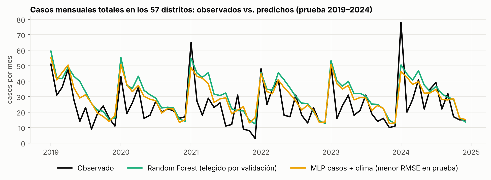

# Predicción de leishmaniosis cutánea en Cajamarca — Grupo 4

Proyecto de Inteligencia Artificial Aplicada (1INF62, PUCP, 2026-2).

**Integrantes:** Dhanny Sebastian Ramirez Rivera, Sergio Estéfano Huamán Noriega, Leonardo Jaime Flores Vera y Franz Javier Vilcapoma Madueño.

## Problema y objetivo

Cajamarca concentra el 9,3 % de los casos de leishmaniosis notificados en el Perú entre 2000 y 2024. Anticipar cuántos casos tendrá un distrito el mes siguiente, o si vivirá un brote, ayudaría a orientar la búsqueda activa y el control vectorial.

El objetivo es comparar cinco modelos de aprendizaje automático en dos tareas por distrito y mes:

- **Casos (regresión):** número de casos del mes siguiente.
- **Alerta (clasificación):** si ese mes supera la media del distrito más dos desviaciones estándar.

También se mide si añadir clima rezagado (lluvia y temperatura) mejora la predicción.

## Metodología

1. **Datos:** casos de vigilancia del CDC-MINSA (2000–2024) y clima diario de 26 estaciones SENAMHI, asignadas a cada distrito por cercanía a las localidades con casos.
2. **Preparación:** panel distrito × mes de 57 distritos con al menos 50 casos en el ajuste; rezagos de casos de 1, 2, 3 y 12 meses, media de 3 meses, estacionalidad y clima de 1 a 3 meses antes. El clima termina en 2015 y se rellenó con el mismo mes de años anteriores.
3. **Modelos** (`src/models.py`):
   - lineal (Ridge / regresión logística);
   - árbol de decisión;
   - Random Forest;
   - MLP;
   - CNN temporal.
4. **Evaluación** (`src/evaluation.py`):
   - partición temporal: ajuste 2001–2015, validación 2016–2018, prueba 2019–2024;
   - métricas: RMSE, MAE, PR-AUC y alertas detectadas;
   - referencias: reglas simples.

## Resultados

| Modelo (solo casos) | RMSE ↓ | MAE ↓ | PR-AUC ↑ |
|---|---:|---:|---:|
| Lineal | 0,940 | 0,583 | 0,107 |
| Árbol de decisión | 0,941 | 0,611 | 0,093 |
| **Random Forest** (elegido por validación) | **0,926** | 0,598 | 0,120 |
| MLP | 0,922 | 0,575 | 0,121 |
| CNN | 0,938 | 0,621 | 0,112 |
| Regla: siempre cero | 1,100 | 0,432 | — |
| Clasificador al azar | — | — | 0,029 |

- **Mejores modelos:** Random Forest y MLP, empatados en la práctica.
- **Frente a reglas simples:** reducen el RMSE ~16 % frente a "siempre cero" y detectan alertas ~4 veces mejor que el azar.
- **Clima:** casi no cambia los resultados, porque los datos de SENAMHI terminan en 2015.

Tabla completa en [`results/metrics.csv`](results/metrics.csv), resumen y análisis en [`results/model_comparison.txt`](results/model_comparison.txt) y paper en [`report.pdf`](report.pdf).



## Estructura

```text
├── README.md
├── ENTREGABLE_PARCIAL.md        # checklist semana 8
├── ENTREGABLE_FINAL.md          # checklist semana 15
├── data/
│   ├── raw/                     # casos CDC-MINSA, clima SENAMHI, coordenadas INEI
│   └── processed/               # paneles distrito × mes con y sin clima
├── notebooks/
│   ├── 01_eda.ipynb             # EDA de casos
│   ├── 01b_eda_clima.ipynb      # EDA de clima e integración
│   ├── 02_modelos.ipynb         # implementación y comparación de modelos
│   ├── 03_baseline.ipynb        # líneas base (entregable parcial)
│   └── 04_arbol_decision.ipynb  # árbol de decisión (entregable parcial)
├── src/
│   ├── preprocessing.py         # limpieza y panel mensual
│   ├── integracion_clima.py     # clima y asignación de estaciones
│   ├── models.py                # los 5 modelos
│   ├── evaluation.py            # métricas y evaluación
│   ├── experimento_clima.py     # entrenamiento y selección por validación
│   ├── resultados_finales.py    # metrics.csv, plots/ y model_comparison.txt
│   ├── ejecutar.py              # punto de entrada
│   └── tests/
├── results/
│   ├── metrics.csv              # tabla comparativa
│   ├── plots/                   # gráficos (EDA, árbol y resultados finales)
│   ├── model_comparison.txt     # resumen de resultados y análisis
│   └── experimento_clima/       # métricas, predicciones y diagnósticos completos
├── papers/                      # paper_integrante1.pdf … paper_integrante4.pdf y resúmenes
├── docs/                        # guía del pipeline, análisis, decisiones, report.docx
├── registro_de_pruebas/         # versiones probadas y retiradas
├── report.pdf                   # paper final
├── presentation.pdf             # slides
└── requirements.txt
```

## Cómo ejecutar

Requiere Python 3.12 o superior. Todos los comandos se corren desde la raíz del repositorio.

```bash
pip install -r requirements.txt          # versiones exactas: requirements-lock.txt

python -m unittest discover -s src/tests -v                     # pruebas
python src/ejecutar.py --modo experimento-v1 --reutilizar-datos  # entrena los 5 modelos (~1-2 min en CPU)
python src/resultados_finales.py                                 # metrics.csv, plots/ y model_comparison.txt
```

Otros modos:

- `python src/ejecutar.py --modo datos`: regenera los datos procesados desde `data/raw/`.
- `python src/ejecutar.py --modo equipo70`: árbol original vs Random Forest en 70 distritos.
- `python src/ejecutar.py --verificar`: comprueba los archivos contra `MANIFIESTO.json`.

Los notebooks se abren con `jupyter notebook notebooks/`. La guía paso a paso está en [`docs/GUIA_DEL_PIPELINE.md`](docs/GUIA_DEL_PIPELINE.md).

## Datos y fuentes

- Casos: [vigilancia de leishmaniosis, CDC-MINSA](data/raw/descripcion_dataset_leishmaniosis.md) (datos abiertos).
- Clima y coordenadas: [SENAMHI e INEI](data/raw/external/FUENTES.md).
- Papers revisados: [`papers/`](papers/).
