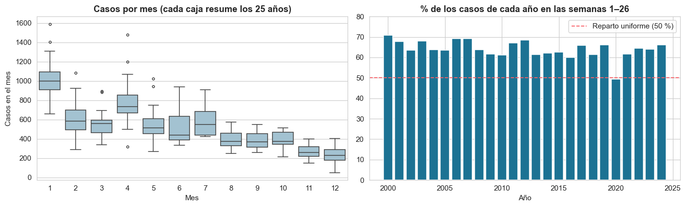
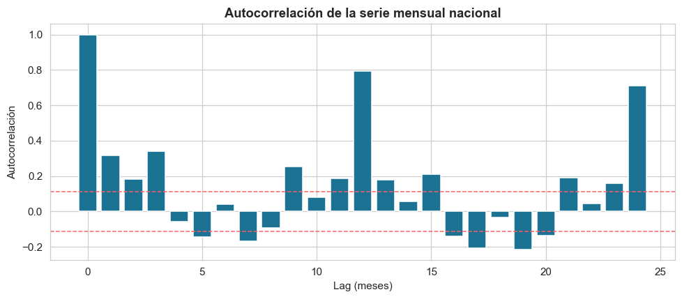

# Predicción de leishmaniosis cutánea en Cajamarca (Perú)

Proyecto del Grupo 4 para anticipar los **casos mensuales de leishmaniosis cutánea por distrito** del departamento de Cajamarca (regresión) y detectar los **meses de alerta** (clasificación). Se usa el historial de casos del CDC-MINSA 2000–2024 y, donde hay cobertura, el clima de las estaciones de SENAMHI.

> **Estado:** análisis exploratorio, preprocesamiento, integración del clima y líneas base terminados. Los modelos de la propuesta todavía no están entrenados.

## Integrantes

- Dhanny Sebastian Ramirez Rivera
- Sergio Estéfano Huamán Noriega
- Leonardo Jaime Flores Vera
- Vilcapoma Madueño Franz Javier

Curso: Inteligencia Artificial Aplicada · Docente: Galareta Asian, Ana Paula

## Alcance

El análisis se limita a **Cajamarca**, porque es la región donde se pudo asociar el clima de SENAMHI a los distritos con casos. Los resultados aplican a Cajamarca y no deben extrapolarse al resto del país.

## Datos

| Fuente | Contenido | Ubicación |
|---|---|---|
| CDC-MINSA (RENACE), Plataforma Nacional de Datos Abiertos | 156 819 casos individuales de leishmaniosis cutánea, 2000–2024, 23 departamentos | `data/raw/` · descripción en [`descripcion_dataset_leishmaniosis.md`](data/raw/descripcion_dataset_leishmaniosis.md) |
| SENAMHI | Series diarias de precipitación y temperatura máxima/mínima de 26 estaciones de Cajamarca (y 8 de Cusco, no usadas) | `data/raw/clima/` |
| INEI vía [ubigeo-peru-aumentado](https://github.com/jmcastagnetto/ubigeo-peru-aumentado) | Coordenadas de distritos y centros poblados de Cajamarca; coordenadas de las estaciones | `data/raw/external/` · fuentes en [`FUENTES.md`](data/raw/external/FUENTES.md) |

El portal advierte que la información es provisional y que las semanas más recientes pueden estar subestimadas por retraso en la notificación.

## Estructura del repositorio

```
.
├── data/
│   ├── raw/
│   │   ├── clima/    # series diarias SENAMHI (cajamarca/, cusco/)
│   │   ├── external/ # coordenadas de estaciones, distritos y centros poblados
│   │   └── ...       # CSV de vigilancia y su descripción
│   └── processed/    # se genera al correr los scripts (no está en el repo)
├── notebooks/
│   ├── 01_eda.ipynb          # análisis exploratorio de los casos
│   ├── 02_eda_clima.ipynb    # exploración del clima y su cobertura
│   └── 03_baseline.ipynb     # líneas base de regresión y alerta
├── src/
│   ├── preprocessing.py       # limpieza, panel distrito × mes, variables, alerta, escalado
│   └── integracion_clima.py   # une el clima de SENAMHI con los casos de Cajamarca
├── results/
│   ├── plots/                 # gráficos del EDA y del baseline
│   └── baseline_metricas.csv  # métricas de las líneas base
├── papers/           # papers de referencia y resúmenes
├── PIPELINE_PROPUESTO.md  # diseño del pipeline y de los modelos
├── ENTREGABLE_PARCIAL.md  # checklist del entregable de la semana 8
└── requirements.txt       # dependencias
```

## Cómo reproducirlo

Requiere Python 3; las dependencias están en `requirements.txt` (`imbalanced-learn` solo se usa para SMOTE).

```bash
pip install -r requirements.txt

# Panel mensual distrito × mes (todo el país) -> data/processed/
python src/preprocessing.py
python src/preprocessing.py --exclude-week1   # sensibilidad sin la semana 1

# Panel de Cajamarca con clima -> data/processed/dataset_cajamarca.csv
python src/integracion_clima.py
```

Ejecutar siempre desde la raíz del repositorio. Los notebooks de `notebooks/` reproducen el análisis exploratorio (`01_eda`, `02_eda_clima`) y las líneas base (`03_baseline`).

## Metodología

- **Unidad de análisis:** distrito × mes, con distritos que acumulan un mínimo de casos (hoy 50, constante `UMBRAL_CASOS`). Los casos se agregan por mes porque a escala semanal solo el 6,8 % de las celdas distrito-semana tiene casos.
- **Variables de casos (7):** `lag1`, `lag2`, `lag3`, `lag12`, `media3`, `mes_sin`, `mes_cos`. Todas se calculan con datos anteriores al mes que se predice.
- **Objetivos:** `casos` (regresión) y `alerta` (clasificación). La alerta es provisional: mes en que los casos superan la media del distrito más 2 desviaciones, calculadas solo con entrenamiento.
- **Partición temporal, nunca aleatoria:** entrenamiento hasta 2018 y prueba 2019–2024. Escaladores y SMOTE se ajustan solo con entrenamiento.
- **Clima:** cada distrito toma la estación SENAMHI más cercana a las localidades donde se concentran sus casos. Solo parte de las filas queda con clima.
- **Modelos previstos:** líneas base (último valor y mismo mes del año anterior), regresión lineal/logística, árbol de decisión, KNN, MLP, LSTM y un Transformer exploratorio.
- **Métricas:** RMSE, MAE y MASE para regresión; recall, precisión, F1 y PR-AUC para alerta; gráficos de predicho vs. observado.

El detalle de cada paso, la justificación con los papers y las decisiones abiertas están en [`PIPELINE_PROPUESTO.md`](PIPELINE_PROPUESTO.md).

## Hallazgos del EDA

- Todos los registros son leishmaniosis cutánea (CIE-10 B55.1).
- Marcada **estacionalidad**: entre el 60 % y el 71 % de los casos se notifica en el primer semestre en 24 de los 25 años.
- La serie se parece mucho a sí misma un año después: **autocorrelación de 0,79 en el rezago 12**.
- La **semana 1** concentra el 6,2 % de los casos (unas 2,6 veces sus vecinas), un patrón típico de artefacto de registro; por eso se prueba una sensibilidad sin ella.
- Los valores extremos no se recortan: son los brotes que se quiere predecir.




## Limitaciones

- La información del CDC es provisional y la ubicación corresponde al probable sitio de infección, no a la residencia.
- Solo una parte de los meses tiene clima asociado; falta decidir cómo tratar el resto.
- El clima se asigna por estación más cercana en línea recta, no por interpolación.
- Con unos 300 meses por distrito, los modelos secuenciales (LSTM, Transformer) tienen pocas opciones frente a las líneas base; se presentan como comparación.

## Referencias

Los cuatro papers de referencia y sus resúmenes están en [`papers/`](papers/):

1. Adams et al. (2025), *Environmental Research: Health* — leishmaniosis visceral en Brasil.
2. Donizette, Rocco & de Queiroz (2025), *Operations Research for Health Care* — leishmaniosis en 6 ciudades de Brasil.
3. Araque & Paipa (2026), tesis de maestría, Universidad Santo Tomás — brotes de dengue en Bucaramanga.
4. El Alaoui et al. (2026), *Parasitology International* — leishmaniosis cutánea en Errachidia (Marruecos).

**Datos:** CDC Perú, Ministerio de Salud (MINSA), Red Nacional de Epidemiología (RENACE), Plataforma Nacional de Datos Abiertos. Clima: SENAMHI.
