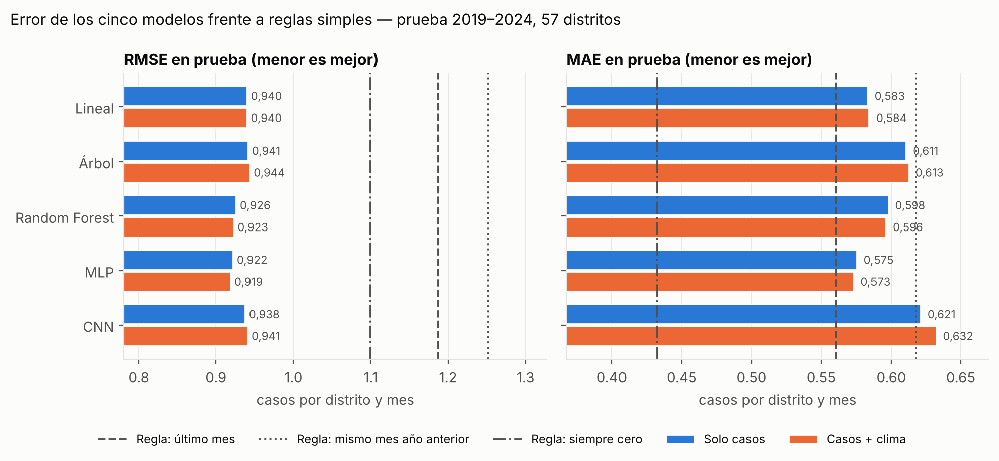

# Predicción de leishmaniosis cutánea en Cajamarca — Grupo 4

Proyecto del curso de Inteligencia Artificial Aplicada (PUCP). Se predice la leishmaniosis cutánea por distrito y mes en Cajamarca, en dos tareas:

- **Casos:** cuántos casos habrá el mes siguiente (regresión).
- **Alerta:** si ese mes habrá un brote, es decir, casos por encima de la media del distrito más dos desviaciones estándar (clasificación).

Se usan los casos de vigilancia del CDC-MINSA (2000–2024) y el clima de estaciones SENAMHI (lluvia y temperaturas). Se comparan cinco modelos contra reglas simples.

**Integrantes:** Dhanny Sebastian Ramirez Rivera, Sergio Estéfano Huamán Noriega, Leonardo Jaime Flores Vera y Franz Javier Vilcapoma Madueño.

## Resultados principales

Prueba 2019–2024, 57 distritos, 4 104 filas distrito × mes. Ajuste con 2001–2015 y validación con 2016–2018.

| Modelo | Entradas | RMSE ↓ | MAE ↓ | PR-AUC alertas ↑ |
|---|---|---:|---:|---:|
| Lineal (Ridge / Logística) | Solo casos | 0,940 | 0,583 | 0,107 |
| Árbol de decisión | Solo casos | 0,941 | 0,611 | 0,093 |
| **Random Forest** (elegido por validación) | Solo casos | **0,926** | 0,598 | 0,120 |
| Red neuronal MLP | Solo casos | 0,922 | 0,575 | 0,121 |
| Red convolucional CNN | Solo casos | 0,938 | 0,621 | 0,112 |
| Regla: siempre cero | — | 1,100 | 0,432 | — |
| Clasificador al azar | — | — | — | 0,029 |

Los modelos con casos + clima, la precisión, el recall y las falsas alarmas están en la [tabla comparativa completa](pipeline/results/finales/tabla_comparativa.md).

**Conclusiones:**

- Random Forest y MLP son los mejores, con diferencias menores al 1 % entre ellos.
- Los modelos reducen el RMSE alrededor de un 16 % frente a la mejor regla simple ("siempre cero") y detectan alertas unas cuatro veces mejor que el azar.
- El clima casi no cambia los resultados, porque los datos de SENAMHI disponibles terminan en 2015.

El análisis completo, con el porqué, las limitaciones y los hallazgos, está en [pipeline/ANALISIS_RESULTADOS.md](pipeline/ANALISIS_RESULTADOS.md).

<p>
  
  
</p>

## Estructura del repositorio

```text
├── pipeline/                  # propuesta final, autocontenida y ejecutable
│   ├── codigo/                # preprocesamiento, integración de clima, modelos y reportes
│   ├── data/                  # datos crudos (casos, clima, coordenadas) y procesados
│   ├── results/
│   │   ├── finales/           # tabla comparativa y gráficos del entregable final
│   │   ├── experimento_clima/ # métricas, predicciones y diagnósticos de los 5 modelos
│   │   └── comparacion_70_distritos/
│   ├── fuentes/               # papers de referencia y decisiones del equipo
│   ├── ANALISIS_RESULTADOS.md # qué modelo funcionó mejor, por qué, limitaciones
│   ├── GUIA_DEL_PIPELINE.md   # paso a paso del pipeline
│   └── DECISIONES_Y_FUENTES.md# justificación y citas de cada decisión
├── docs/                      # paper académico y presentación
├── registro_de_pruebas/       # historial de versiones probadas y retiradas (649 filas de métricas)
└── material_previo/           # EDA, línea base y árbol original del equipo (notebooks, src, papers)
```

## Cómo ejecutar

Requiere Python 3.12 o superior.

```bash
cd pipeline
python -m pip install -r requirements-lock.txt

python -m unittest discover -s codigo/tests -v                 # pruebas de integridad
python codigo/ejecutar.py --modo experimento-v1 --reutilizar-datos   # entrena los 5 modelos (~1-2 min)
python codigo/resultados_finales.py                             # tabla y gráficos de results/finales/
python codigo/ejecutar.py --modo equipo70                       # árbol original vs Random Forest, 70 distritos
```

`python codigo/ejecutar.py --modo datos` regenera los datasets procesados desde los datos crudos. `python codigo/ejecutar.py --verificar` comprueba los archivos contra `MANIFIESTO.json`. La guía completa está en [pipeline/GUIA_DEL_PIPELINE.md](pipeline/GUIA_DEL_PIPELINE.md).

## Datos y fuentes

- Casos: [datos abiertos de vigilancia de leishmaniosis, CDC-MINSA](pipeline/data/raw/descripcion_dataset_leishmaniosis.md).
- Clima y coordenadas: [estaciones SENAMHI, centros poblados y distritos del INEI](pipeline/data/raw/external/FUENTES.md).
- Papers de referencia: [pipeline/fuentes/papers/](pipeline/fuentes/papers/).

## Comparación adicional: 70 distritos

Reproduce el árbol de decisión original del equipo sobre los mismos 70 distritos y las mismas 5 040 filas de prueba:

| Modelo | RMSE | MAE |
|---|---:|---:|
| Árbol original, solo casos | 0,907 | 0,576 |
| Random Forest, solo casos | 0,892 | 0,565 |
| Random Forest, clima con imputación estacional del 52 % | 0,891 | 0,566 |

Los números no son comparables con la tabla principal porque usan otro grupo de distritos. Fuente: [D23](pipeline/DECISIONES_Y_FUENTES.md#d23).
