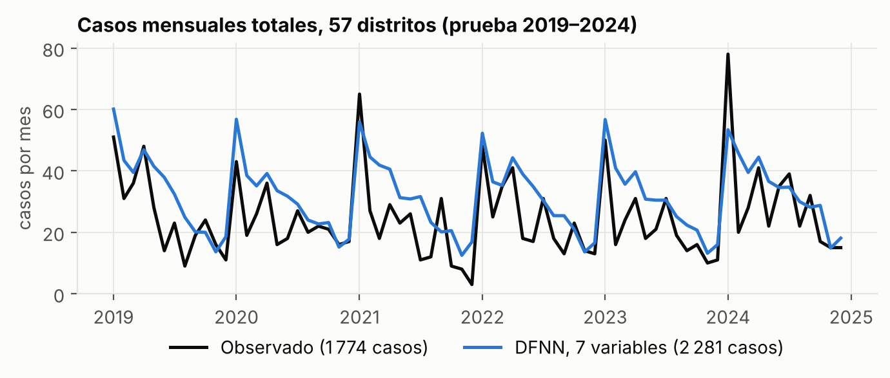

# Predicción de leishmaniosis cutánea en Cajamarca — Grupo 4

Proyecto de Inteligencia Artificial Aplicada (1INF62, PUCP, 2026-2).

**Integrantes:** Dhanny Sebastian Ramirez Rivera, Sergio Estéfano Huamán Noriega, Leonardo Jaime Flores Vera y Franz Javier Vilcapoma Madueño.

## Problema y objetivo

Cajamarca concentra el 9,3 % de los casos de leishmaniosis notificados en el Perú entre 2000 y 2024. Anticipar cuántos casos tendrá un distrito el mes siguiente, o si vivirá un brote, ayudaría a orientar la búsqueda activa y el control vectorial.

El objetivo es comparar cinco modelos de aprendizaje automático y los métodos de tres papers revisados en dos tareas por distrito y mes:

- **Casos (regresión):** número de casos del mes siguiente.
- **Alerta (clasificación):** si ese mes supera la media del distrito más dos desviaciones estándar.

También se mide si añadir clima rezagado (lluvia y temperatura) mejora la predicción.

## Metodología

1. **Datos:** casos de vigilancia del CDC-MINSA (2000–2024) y clima diario de 26 estaciones SENAMHI, asignadas a cada distrito por cercanía a las localidades con casos.
2. **Preparación:** panel distrito × mes de 57 distritos con al menos 50 casos en el ajuste; rezagos de casos de 1, 2, 3 y 12 meses, media de 3 meses, estacionalidad y clima de 1 a 3 meses antes. El clima termina en 2015 y se rellenó con el mismo mes de años anteriores.
3. **Modelos del equipo** (`src/models.py`), cada uno con dos configuraciones candidatas:
   - lineal (Ridge / regresión logística);
   - árbol de decisión;
   - Random Forest;
   - MLP;
   - CNN temporal.
4. **Réplicas de los papers:**
   - XGBoost de Adams et al. (paper 1);
   - redes SFNN1, SFNN2 y DFNN de Donizette et al. (paper 2);
   - SARIMA de El Alaoui et al. (paper 4).

   El paper 3 (Araque y Paipa) no se replicó, porque trata dengue con datos semanales.
5. **Evaluación** (`src/evaluation.py`):
   - partición temporal: ajuste 2001–2015, validación 2016–2018 y prueba 2019–2024, con reentrenamiento en 2001–2018 antes de la prueba;
   - el modelo final es el de menor RMSE de validación entre todos los modelos, con el mismo criterio para el equipo y los papers;
   - métricas: RMSE, MAE y MASE para casos; PR-AUC, F1, alertas detectadas, falsas alarmas y EER para alertas;
   - referencias: reglas simples (último mes, mismo mes del año anterior, siempre cero y clasificador al azar).

## Resultados

Prueba 2019–2024, 57 distritos y 4 104 filas, solo con variables de casos:

| Modelo | RMSE val. ↓ | RMSE ↓ | MAE ↓ | PR-AUC ↑ | Alertas detectadas |
|---|---:|---:|---:|---:|---:|
| Lineal | 1,129 | 0,940 | 0,583 | 0,107 | 47/120 |
| Árbol de decisión | 1,153 | 0,941 | 0,611 | 0,093 | 43/120 |
| Random Forest | 1,127 | 0,926 | 0,598 | 0,120 | 66/120 |
| MLP | 1,131 | 0,922 | 0,575 | 0,121 | 65/120 |
| CNN | 1,128 | 0,938 | 0,621 | 0,112 | 50/120 |
| **Paper 2 · DFNN, 7 variables** (elegido por validación) | **1,115** | **0,916** | 0,602 | **0,158** | 70/120 |
| Paper 4 · SARIMA por AIC | 1,158 | 0,946 | 0,556 | 0,083 | 66/120 |
| Regla: siempre cero | — | 1,100 | 0,432 | — | — |
| Clasificador al azar | — | — | — | 0,029 | — |

- **Modelo final:** la DFNN del paper 2 con las 7 variables de casos, que tiene el menor RMSE de validación de todos los modelos.
  - Casos: RMSE 0,916 (0,922 ± 0,016 con 5 semillas), 17 % menor que "siempre cero".
  - Alertas: PR-AUC 0,158, más de cinco veces la del azar. Detecta 70 de 120 brotes, con 664 falsas alarmas.
- **Empate en casos:** la MLP (0,922) y el Random Forest (0,926) quedan a menos de 0,01 de la DFNN, una diferencia menor que su variación entre semillas. La ventaja de la DFNN está en las alertas.
- **Pesan más las entradas que la arquitectura:** pasar de los 3 rezagos del paper 2 a las 7 variables del equipo bajó el RMSE medio de las redes de 0,956 a 0,931.
- **Otros papers:** el XGBoost del paper 1 empata con el Random Forest en 70 distritos (0,891 frente a 0,892). El SARIMA del paper 4 con el orden del paper es peor que "siempre cero".
- **Clima:** agregarlo cambió el RMSE en 0,0034 como máximo, y el historial de casos concentra el 86 % de la importancia del Random Forest. No se puede afirmar ni descartar su aporte, porque los datos de SENAMHI terminan en 2015.

Tabla completa en [`results/metrics.csv`](results/metrics.csv) y resumen en [`results/model_comparison.txt`](results/model_comparison.txt). El reporte final, en formato IEEE, está en [`report.pdf`](report.pdf), y las diapositivas, en [`presentation.pdf`](presentation.pdf).



## Estructura

```text
├── README.md
├── ENTREGABLE_PARCIAL.md        # checklist semana 8
├── ENTREGABLE_FINAL.md          # checklist semana 15
├── data/
│   ├── raw/                     # casos CDC-MINSA, clima SENAMHI, coordenadas INEI
│   └── processed/               # paneles distrito × mes con y sin clima
├── notebooks/
│   ├── 01_eda.ipynb             # EDA de casos
│   ├── 01b_eda_clima.ipynb      # EDA de clima e integración
│   ├── 02_modelos.ipynb         # implementación y comparación de modelos
│   ├── 03_baseline.ipynb        # líneas base (entregable parcial)
│   ├── 04_arbol_decision.ipynb  # árbol de decisión (entregable parcial)
│   ├── 05_paper_integrante1_xgboost.ipynb  # réplica del paper 1 (XGBoost)
│   ├── 06_paper_integrante2_redes.ipynb    # réplica del paper 2 (SFNN/DFNN)
│   └── 07_paper_integrante4_sarima.ipynb   # réplica del paper 4 (SARIMA)
├── src/
│   ├── preprocessing.py         # limpieza y panel mensual
│   ├── integracion_clima.py     # clima y asignación de estaciones
│   ├── models.py                # los 5 modelos
│   ├── evaluation.py            # métricas y evaluación
│   ├── experimento_clima.py     # entrenamiento y selección por validación
│   ├── resultados_finales.py    # metrics.csv, plots/ y model_comparison.txt
│   ├── reporte_experimento_clima.py, verificar_experimento_clima.py  # informe y auditoría del experimento
│   ├── comparacion_70_distritos.py  # árbol original vs Random Forest en 70 distritos
│   ├── p1_adams.py              # XGBoost del paper 1 (Adams et al.)
│   ├── modelo_paper2.py         # redes SFNN1/SFNN2/DFNN del paper 2
│   ├── modelo_paper4.py         # SARIMA del paper 4 (Box-Jenkins, AIC, Ljung-Box)
│   ├── comparacion_final.py     # equipo + papers 2 y 4: accuracy, ROC-AUC, EER, matriz de confusión
│   ├── figuras_reporte.py       # figuras 2 y 3 del reporte (DFNN y curvas PR de todos los modelos)
│   ├── ejecutar.py              # punto de entrada
│   └── tests/
├── results/
│   ├── metrics.csv              # tabla comparativa
│   ├── plots/                   # todos los gráficos (EDA, árbol, resultados finales, papers)
│   ├── model_comparison.txt     # resumen de resultados y análisis
│   ├── analisis/                # análisis extendido de resultados y de las réplicas de los papers 2 y 4
│   ├── experimento_clima/       # métricas, predicciones y diagnósticos completos
│   ├── comparacion_70_distritos/  # árbol original vs Random Forest
│   ├── p1_adams/                # XGBoost del paper 1 (métricas, predicciones, SHAP)
│   ├── paper2/, paper2_historico/  # redes del paper 2 (métricas, validación, predicciones)
│   ├── paper4/, paper4_historico/  # SARIMA del paper 4 (métricas, órdenes por distrito, predicciones)
│   └── comparacion_final/       # tablas equipo + papers 2 y 4
├── papers/                      # paper_integrante1.pdf … paper_integrante4.pdf y resúmenes
├── report.pdf                   # reporte final (formato IEEE)
├── presentation.pdf             # slides
└── requirements.txt
```

## Cómo ejecutar

Requiere Python 3.12 o superior. Todos los comandos se corren desde la raíz del repositorio.

```bash
pip install -r requirements.txt          # en macOS, xgboost requiere: brew install libomp

python -m unittest discover -s src/tests -v                     # pruebas
python src/ejecutar.py --modo experimento-v1 --reutilizar-datos  # entrena los 5 modelos (~1-2 min en CPU)
python src/resultados_finales.py                                 # metrics.csv, plots/ y model_comparison.txt

# Réplica del paper 2 (≈50 min el oficial y ≈35 min el histórico; pueden correr en paralelo)
python src/modelo_paper2.py
python src/modelo_paper2.py --protocolo historico
# Réplica del paper 4, SARIMA (≈1 min por protocolo)
python src/modelo_paper4.py
python src/modelo_paper4.py --protocolo historico
python src/comparacion_final.py                                  # results/comparacion_final/ y plots/comparacion_final_*.png
python src/figuras_reporte.py                                    # figuras 2 y 3 del reporte en plots/
```

La réplica del paper 1 (XGBoost) se ejecuta desde `notebooks/05_paper_integrante1_xgboost.ipynb`, que usa `src/p1_adams.py`.

Otros modos:

- `python src/ejecutar.py --modo datos`: regenera los datos procesados desde `data/raw/`.
- `python src/ejecutar.py --modo equipo70`: árbol original vs Random Forest en 70 distritos.

Los notebooks se abren con `jupyter notebook notebooks/`. El análisis extendido está en [`results/analisis/`](results/analisis/).

## Datos y fuentes

- Casos: [vigilancia de leishmaniosis, CDC-MINSA](data/raw/descripcion_dataset_leishmaniosis.md) (datos abiertos).
- Clima y coordenadas: [SENAMHI e INEI](data/raw/external/FUENTES.md).
- Papers revisados: [`papers/`](papers/).

## Contribuciones

| Integrante | Contribución |
|---|---|
| Dhanny Sebastian Ramirez Rivera | Paper 1 (Adams et al.) y su réplica con XGBoost; EDA del dataset de leishmaniosis y preprocesamiento; organización del repositorio. |
| Sergio Estéfano Huamán Noriega | Paper 2 (Donizette et al.) y su réplica con SFNN/DFNN; propuesta de modelos; entregable parcial. |
| Leonardo Jaime Flores Vera | Paper 3 (Araque y Paipa); integración del clima SENAMHI y pipeline de experimentos. |
| Franz Javier Vilcapoma Madueño | Paper 4 (El Alaoui et al.) y su réplica con SARIMA; árbol de decisión; estructura del entregable final. |

El uso de IA en el proyecto se declara en [`report.pdf`](report.pdf).
