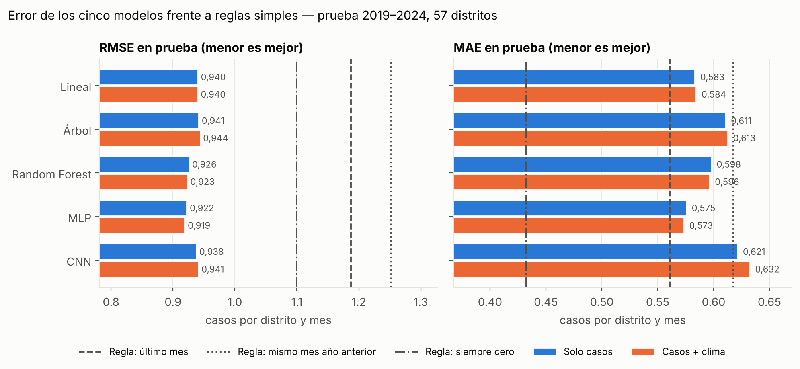
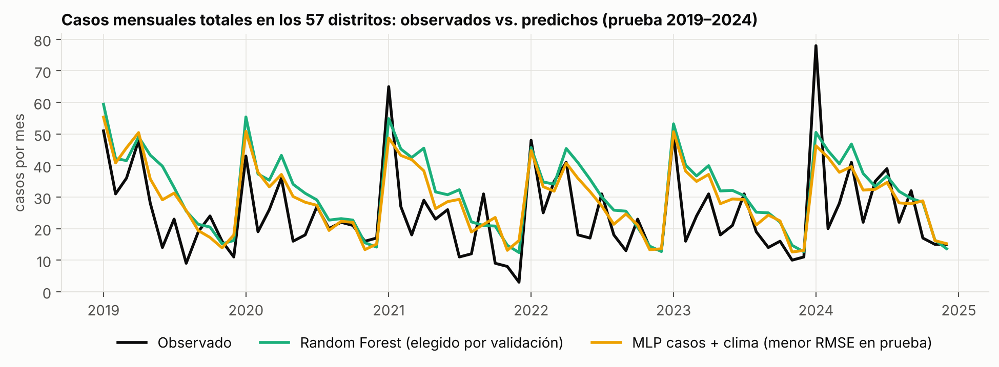
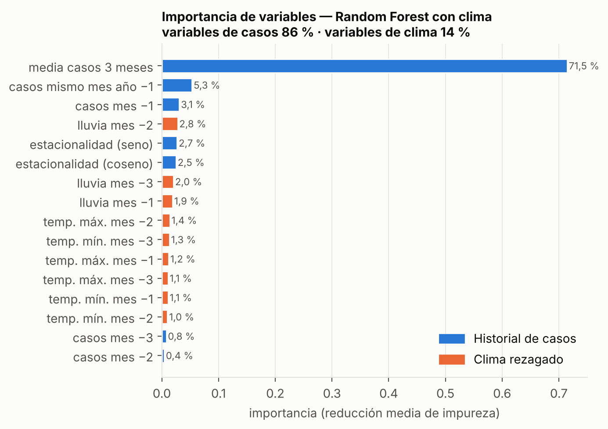
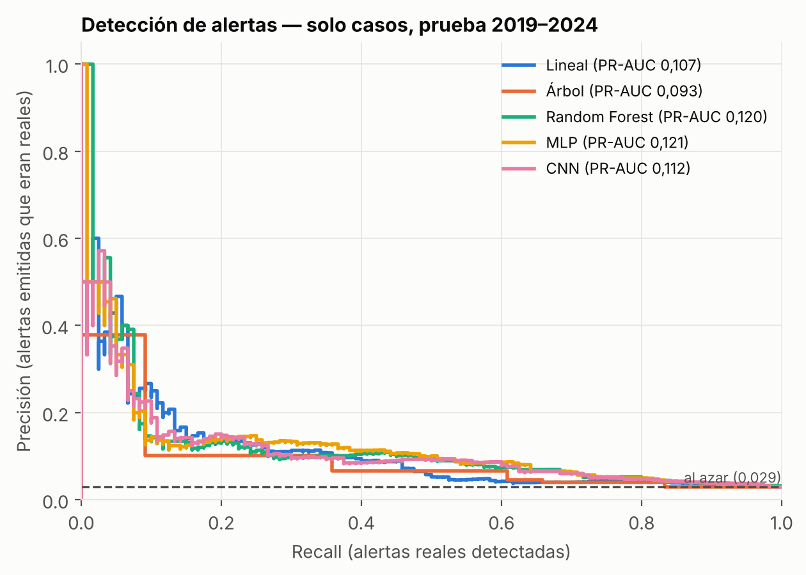

# Análisis de resultados — entregable final

Este documento responde qué modelo funcionó mejor, por qué, qué limitaciones tiene el estudio y qué aprendimos. Todas las cifras salen de `results/experimento_clima/`, `results/metrics.csv` y `results/plots/`, generados desde la raíz del repositorio con:

```bash
python src/ejecutar.py --modo experimento-v1 --reutilizar-datos
python src/resultados_finales.py
```

## 1. Qué se comparó

- **Problema:** predecir la leishmaniosis cutánea en Cajamarca, por distrito y mes, en dos tareas:
  - **Casos (regresión):** cuántos casos habrá el mes siguiente.
  - **Alerta (clasificación):** si ese mes superará la media del distrito más dos desviaciones estándar del entrenamiento, lo que se considera un brote.
- **Datos:**
  - casos de vigilancia CDC-MINSA 2000–2024;
  - clima SENAMHI (lluvia, temperatura máxima y temperatura mínima) de las estaciones más cercanas a las localidades con casos.
- **Modelos:** cinco tipos de modelo, todos entrenados para ambas tareas:
  - lineal (Ridge para casos, regresión logística para alertas);
  - árbol de decisión;
  - Random Forest;
  - red neuronal MLP;
  - red convolucional temporal (CNN).
- **Entradas:** cada modelo se entrena dos veces, solo con el historial de casos y con casos más clima de los tres meses anteriores.
- **Referencias simples:** repetir el último mes, repetir el mismo mes del año anterior, predecir siempre cero y, para las alertas, un clasificador al azar.
- **Partición temporal (protocolo oficial, 57 distritos):**
  - ajuste: 2001–2015;
  - validación: 2016–2018, para elegir hiperparámetros y el umbral de alerta;
  - prueba: 2019–2024, con 4 104 filas distrito × mes.

## 2. Tabla comparativa

Tabla completa con precisión, recall y falsas alarmas: [results/tabla_comparativa.md](../tabla_comparativa.md) (CSV: [results/metrics.csv](../metrics.csv)).

| Modelo | Entradas | RMSE ↓ | MAE ↓ | PR-AUC ↑ | Alertas detectadas | Falsas alarmas |
|---|---|---:|---:|---:|---:|---:|
| Lineal | Solo casos | 0,940 | 0,583 | 0,107 | 47/120 | 443 |
| Lineal | Casos + clima | 0,940 | 0,584 | 0,112 | 74/120 | 1 890 |
| Árbol de decisión | Solo casos | 0,941 | 0,611 | 0,093 | 43/120 | 380 |
| Árbol de decisión | Casos + clima | 0,944 | 0,613 | 0,135 | 41/120 | 261 |
| **Random Forest** | **Solo casos** | **0,926** | **0,598** | **0,120** | **66/120** | **759** |
| Random Forest | Casos + clima | 0,923 | 0,596 | 0,154 | 71/120 | 734 |
| MLP | Solo casos | 0,922 | 0,575 | 0,121 | 65/120 | 699 |
| MLP | Casos + clima | 0,919 | 0,573 | 0,132 | 59/120 | 713 |
| CNN | Solo casos | 0,938 | 0,621 | 0,112 | 50/120 | 532 |
| CNN | Casos + clima | 0,941 | 0,632 | 0,104 | 23/120 | 146 |
| Regla: último mes | — | 1,187 | 0,561 | — | — | — |
| Regla: mismo mes del año anterior | — | 1,252 | 0,617 | — | — | — |
| Regla: siempre cero | — | 1,100 | 0,432 | — | — | — |
| Clasificador al azar | — | — | — | 0,029 | — | — |



## 3. Qué modelo funcionó mejor

> **Modelo final del proyecto:** al sumar las réplicas de los papers, la DFNN del paper 2 con las 7 variables de casos tiene el menor RMSE de validación (1,115) y es el modelo que analiza `report.pdf`: RMSE 0,916 en prueba y PR-AUC 0,158. Esta sección analiza el mejor modelo del equipo, que empata con ella en casos. La comparación está en [`ANALISIS_PAPER2.md`](ANALISIS_PAPER2.md) y en `../model_comparison.txt`.

**Random Forest con solo casos** es el mejor modelo del equipo. Fue el mejor en validación en las dos tareas (RMSE de validación 1,127 y PR-AUC de validación 0,102), y ese es el criterio del pipeline: el periodo de prueba no se usa para elegir.

En prueba:

- **Error:** RMSE 0,926 casos, un 16 % menor que "siempre cero" y un 22 % menor que "último mes".
- **Alertas:** PR-AUC 0,120, unas cuatro veces la de un clasificador al azar (0,029). Detecta 66 de los 120 meses de brote (55 %).

La MLP obtuvo el RMSE más bajo en prueba (0,919 con clima). La diferencia con el Random Forest es de 0,007 casos por distrito y mes, menos del 1 %. Con una sola semilla y un solo periodo de prueba, **no se puede afirmar que uno sea mejor que el otro**. Lo correcto es decir que los dos modelos no lineales, Random Forest y MLP, quedan en el primer grupo. El lineal y la CNN van detrás (0,938–0,941) y el árbol individual es el más débil (0,941–0,944).



## 4. Por qué

- **El historial reciente de casos explica casi todo.** En el Random Forest con clima, la media de los últimos tres meses concentra el 71,5 % de la importancia, y las variables de casos suman el 86 %. Para conteos pequeños y ruidosos, la persistencia es la señal más fuerte. Por eso incluso el modelo lineal queda cerca de los demás.
- **Random Forest y MLP suavizan mejor el ruido.** Tres de cada cuatro meses-distrito de la prueba tienen cero casos y el máximo es 14. Un árbol solo divide los datos en pocos grupos y salta entre valores. El Random Forest promedia 100 árboles y la MLP aprende una función continua, así que los dos reducen la varianza.
- **La CNN no aprovecha su ventaja.** Una convolución sirve para encontrar patrones en secuencias largas, pero aquí solo ve tres meses y hay pocos datos por distrito. En la práctica funciona como una MLP con más parámetros y menos estabilidad.
- **En alertas, el clima ayuda poco y de forma inestable.** Con clima, el Random Forest sube de 0,120 a 0,154 de PR-AUC y el árbol de 0,093 a 0,135, pero el lineal pasa a 1 890 falsas alarmas y la CNN solo detecta 23 de 120. No es una mejora consistente.



## 5. Qué aportó la data ambiental (clima)

- **Efecto en casos:** cambia el RMSE en menos de 0,004 casos por distrito y mes, hacia arriba o hacia abajo según el modelo.
- **Importancia:** el clima suma el 14 % de la importancia del Random Forest, y la mayor parte es la lluvia de dos y tres meses antes. Esto concuerda con la literatura, que describe efectos climáticos con retraso.
- **El motivo principal no es biológico, es de datos:**
  - los registros SENAMHI disponibles terminan en **octubre de 2015**, así que en 2019–2024 no hay clima observado;
  - para cubrir el hueco se rellenó el 52 % de los valores faltantes copiando el mismo mes de años anteriores, y 9 291 de los 11 745 valores rellenados se basan a su vez en otros rellenados;
  - aun así, solo el **18 %** de las predicciones de prueba tuvo clima completo; el resto usó el modelo de solo casos.
- **Conclusión:** con estos datos no se puede afirmar ni descartar que el clima mejore la predicción. Probarlo requiere clima observado para 2016–2024.

## 6. Hallazgos

1. **En MAE, las reglas simples ganan.** "Siempre cero" (0,432) y "último mes" (0,561) tienen menor MAE que todos los modelos (0,573 o más). Los modelos se entrenan minimizando el error cuadrático y predicen valores intermedios, como 0,3 casos, en meses que casi siempre tienen cero. Ganan en RMSE porque se equivocan mucho menos en los meses con varios casos, que son los que importan para vigilancia.
2. **Todos los modelos sobreestiman el total.** En 2019–2024 hubo 1 774 casos en los 57 distritos, y los modelos predijeron entre 2 134 y 2 407 (entre 20 % y 36 % de más). La incidencia bajó con el tiempo: el promedio anual fue 618 casos en 2001–2015, 447 en 2016–2018 y 296 en 2019–2024. Los modelos aprendieron un nivel más alto que el actual. La caída de 2020–2021 podría deberse en parte a menos notificación durante la pandemia; es una hipótesis que no se verificó.
3. **El pico de enero se anticipa, pero no su tamaño.** Los casos suben cada enero y los modelos lo detectan. En cambio, subestiman los picos más altos (enero de 2021 y enero de 2024) y sobreestiman los meses tranquilos siguientes.
4. **Los distritos extremos se acercan al promedio.** Los distritos con más casos (San Luis de Lucma, Cachachi y Contumazá) se subestiman, y los más pequeños se sobreestiman ([fig. 5](../plots/fig5_casos_por_distrito.png)).
5. **Detectar brotes cuesta muchas falsas alarmas.** Para detectar el 55 % de los brotes, el Random Forest emite unas 11 alertas falsas por cada alerta verdadera, con una precisión del 8 %. La curva precisión-recall muestra que no hay un umbral que dé a la vez buena precisión y buen recall.



## 7. Limitaciones

- **Clima:** sin observaciones después de 2015; el relleno del 52 % no recupera mediciones reales.
- **Una sola semilla y un solo periodo de prueba:** no hay intervalos de confianza ni pruebas de significancia. Diferencias menores al 1 % deben tratarse como empates.
- **Búsqueda de hiperparámetros mínima:** dos configuraciones por modelo.
- **Prueba ya revisada:** el periodo 2019–2024 se observó en revisiones anteriores; los resultados no equivalen a una validación externa nueva.
- **Alcance:** la comparación oficial usa 57 distritos con al menos 50 casos hasta 2015; los distritos con pocos casos quedan fuera.
- **Alerta:** la definición (media + 2 desviaciones estándar) es una convención y el puntaje no está calibrado. No es un sistema de alerta temprana validado clínicamente.
- **Predicción a un mes:** cada predicción usa los casos reales del mes anterior; no se prueba predecir varios meses hacia adelante.
- **Asignación de estaciones:** la estación más cercana por distancia no corrige por altitud.

## 8. Trabajo futuro

1. **Clima actualizado:** conseguir clima observado o reconstruido para 2016–2024 (SENAMHI reciente, PISCO o ERA5) y repetir la comparación con y sin clima.
2. **Pérdidas para conteos:** usar pérdida de Poisson o binomial negativa, que tratan mejor los meses con cero casos y podrían mejorar el MAE.
3. **Evaluación más robusta:** evaluación con origen móvil (rolling-origin), varias semillas e intervalos de confianza.
4. **Nuevas variables:** variables ambientales como vegetación (NDVI) o altitud, y variables sociales.

## 9. Cambio respecto a V1 en esta revisión

La MLP alcanzaba el límite de 150 iteraciones en los 41 ajustes, es decir, no terminaba de entrenar. Para la entrega final se activó early stopping:

- se reserva el 10 % del tramo de ajuste;
- el entrenamiento se detiene tras 20 épocas sin mejora;
- el máximo es de 1 000 iteraciones.

Los 42 ajustes convergen (entre 24 y 187 iteraciones, según `results/experimento_clima/diagnostico_ajuste.csv`). En la prueba oficial, el RMSE de la MLP pasó de 0,923 a 0,922 con solo casos y de 0,924 a 0,919 con clima.

Los otros modelos no cambian, salvo la CNN, que varía en el tercer decimal por la versión de PyTorch. La comparación de 70 distritos no usa MLP y reproduce exactamente sus cifras.
